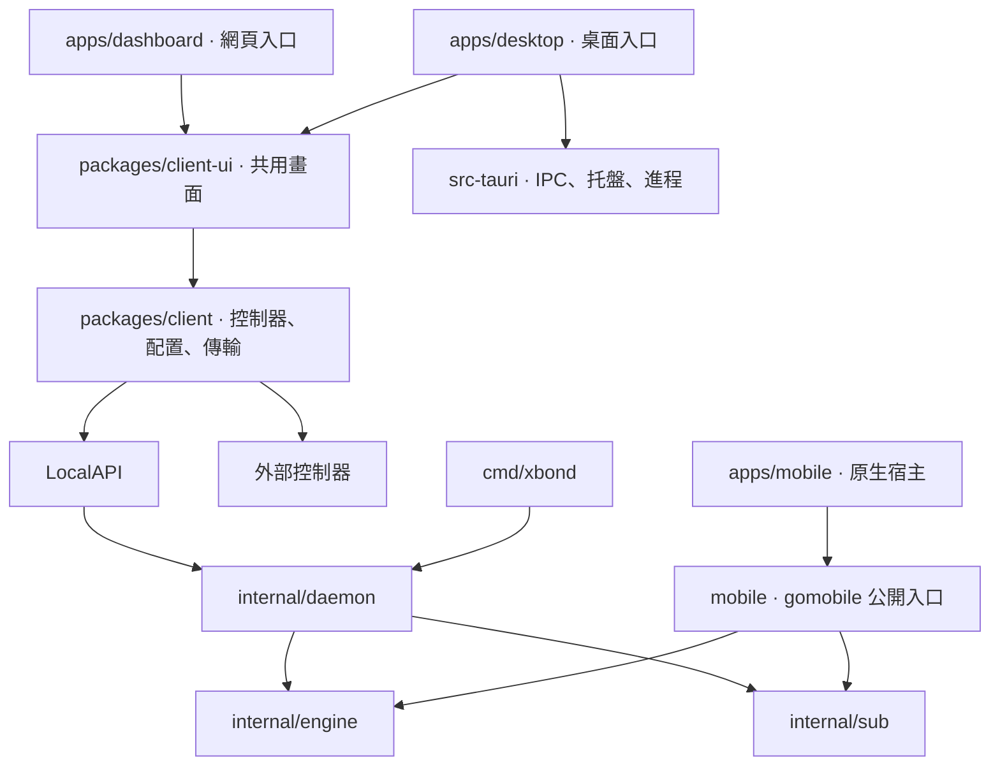

# 用戶端體系

XBond 保留 cloud 與 xbond 兩個倉庫。cloud 擁有帳號、計費、服務權益、配置簽發與 Agent 資料面；xbond 擁有用戶端宿主、控制器操作、本機配置、代理核心與流量接管。詞彙見 [GLOSSARY.md](../../GLOSSARY.md)，目錄決策見 [ADR-002](../adr/002-client-workspace.md)。

## 實際依賴與入口

此圖只畫當前程式碼中的關係。移動宿主使用既有原生程式碼與 Go binding，尚未因此得到完整 React 畫面或原生購買能力。瀏覽器擴充功能在實作時建立自己的宿主，不被當作已交付入口。

| 位置 | 責任與適合放入的程式碼 |
| --- | --- |
| apps/dashboard | HTML、靜態資源、獨立網頁啟動 |
| apps/desktop | 桌面 HTML／JS 入口與 src-tauri 原生殼 |
| apps/mobile | Android／iOS 宿主、系統 VPN 與原生權限接入 |
| packages/client | 不依賴 React 的控制器、來源資料正規化、核心及 LocalAPI 傳輸、策略與串流邏輯 |
| packages/client-ui | React 畫面、互動、Jotai／SWR、語系及樣式；目前的瀏覽器／Tauri 探測亦留在這裡 |
| cmd/xbond | 命令列參數、呈現及入口裝配 |
| internal/daemon | LocalAPI、HTTP 裝配及本機運行流程 |
| internal/engine | sing-box 執行、配置驗證與衍生 |
| internal/sub | 訂閱來源、快取及更新 |
| internal/platform | 作業系統資料位置與系統代理 |
| mobile | gomobile 相容的公開入口與平台回呼 |

Go 保持一個 module；internal 由編譯器限制外部導入，mobile 是公開導入位置。JS 使用 pnpm workspace；每個 package 宣告自己直接使用的依賴，跨 package 導入走具名 exports。宿主可以直接使用 client，無須為重用非視覺能力而載入 client-ui。原始碼位置直接遷移，舊目錄與舊產物佈局不設轉發或回退。

## Module 深度與依賴門禁

client 的 interface 包含控制器身份、操作結果及資料語義；HTTP、WebSocket、LocalAPI 是已有的 adapter。將傳輸與正規化收在同一 module，讓畫面與測試從同一 seam 使用它；depth 來自呼叫者不再需要重寫協定知識，locality 讓修正集中，leverage 由現有桌面與網頁共同取得。

client-ui 擁有呈現與互動；client 不向 client-ui 或 apps 導入，不直接探測 window、document、localStorage 或 chrome。共用 package 不反向導入宿主。pnpm check:architecture 解析 TypeScript／TSX 導入與 re-export，檢查方向、package exports、直接依賴、宿主探測及跨 package 循環；pnpm lint 會執行此檢查。這個門禁補充型別檢查，不宣稱驗證所有執行期動態載入。

配置及資料的磁碟位置由 internal/platform/paths 決定，原始碼搬遷不改變 XBOND_DATA_DIR、訂閱來源、憑據與偏好格式。桌面及網頁各有 HTML／JS 入口，共享 client-ui；Vite 產物仍為根目錄 dist 與 dist-desktop。

## 帳號與購買的責任

帳號會話、訂閱憑據、代理憑據與 LocalAPI token 各有獨立用途。現有 CLI PKCE／device 流程只取得 Subscription Token，不能用它操作帳號訂單。第三方訂閱與外部控制器能力可在無 Cloud 帳號的情況下使用。

用戶端可以呈現套餐、報價、訂單與支付結果；Cloud 擁有價格、優惠、錢包、結帳單、付款核驗及履約。支付呈現依宿主與實際渠道選用 adapter，優先重用現有 Stripe 計費能力。原生帳號授權、原生支付呈現與可能的商店支付需各自交付契約及驗證，並非此輪目錄重組已完成的能力。

帳號登入、付款完成、服務已履約、配置可取得、核心可達、流量接管與外部連通是不同事實。支付回跳或前端成功文案只觸發服務端狀態同步，不直接開通權益。Cloud 的公開用戶端契約由 Cloud 擁有並版本化；xbond 不導入其資料庫或私有計費 implementation，不複製定價與權益規則。

## 後續宿主的落位

Extension 實作時建立 apps/extension，擁有 MV3 background 的生命週期、訊息驗證、儲存、代理設定與認證 adapter；按實際需要重用 client 與適用畫面。PAC 編譯和 sing-box 配置衍生保留各自能力，不以全域 isExtension 分支把全部差異交回頁面。Agent 的 CONNECT 與配置簽發在 cloud 開發，沿用既有准入、選路、計量及限速。

只有真實第二個使用情境才新增 module 或 package；目前沒有預建帳號 SDK、支付框架、PAC 編譯器或空 Extension 工程。運行配置套用的恢復、桌面進程探測與三層狀態歸屬仍需行為切片深化，不能把來源檔案歸位視為這些風險已修復。施工與證據見 [體系重塑任務](../tasks/client-system-reshape.md)。
