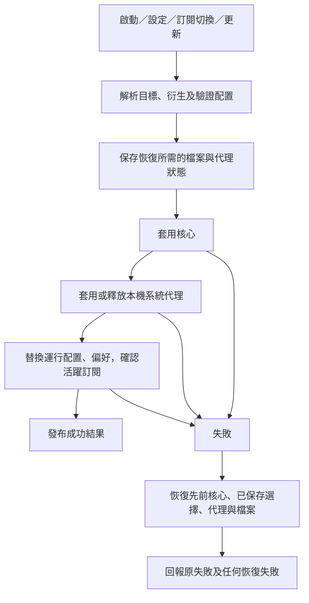

# 運行配置套用與失敗恢復

本契約適用於 CLI 透過 LocalAPI 發起的啟停、設定及訂閱操作、共享用戶端的對應操作，以及本機定時更新。詞彙見 [GLOSSARY.md](../../GLOSSARY.md)，責任落點見 [用戶端體系](../architecture/client-system.md)。

## 範圍與入口

internal/daemon/runtime.go 的 runtimeController 擁有套用順序、偏好及恢復知識。HTTP handler 解碼輸入及回覆結果；定時更新呼叫同一 module，不再自行衍生配置或呼叫 HTTP handler。核心及檔案／系統代理操作是其 implementation 的內部 seam，正式 adapter 與故障替身使用同一操作流程。

活躍訂閱只由訂閱存儲的 ActiveID 表達；偏好不再保存第二份 activeSubId。現階段直接更新契約，不提供舊欄位或舊入口轉接。

## 行為契約

1. 啟動、模式修改及切換訂閱先驗證模式、端口、來源配置與衍生配置。非法輸入及缺少活躍訂閱不得修改已確認的偏好或運行核心。來源配置快取缺失時可先更新來源；這不代表新配置已套用。
2. 核心運行時，修改偏好與切換訂閱均走同一套用順序。偏好與活躍訂閱在套用成功後才發布；失敗時恢復先前的運行配置與已保存的節點選擇。
3. 核心重載先驗證配置、保存目前的節點選擇，再停止舊核心。若新核心無法啟動或有效的節點選擇無法套用，嘗試啟動先前配置及恢復原選擇；新訂閱的選擇不得用於恢復舊核心。節點選擇在重載返回前確認，沒有脫離此次操作的延遲重播；新配置中已不存在的策略組或節點不重播。
4. 每個檔案使用臨時檔、完整寫入、flush 及 rename 替換。偏好、運行配置、訂閱存儲與代理恢復檔的錯誤都不能當作成功。這是進程內操作的失敗恢復，不保證跨多檔案與 OS 設定的崩潰原子性。
5. 系統代理只在接管涉及 sysproxy 時操作；僅端口模式不讀寫宿主代理。首次接管保存原設定，之後切換端口不覆蓋原設定；釋放或停止時嘗試恢復原設定。無法取得完整恢復資料時，在變更前拒絕操作。
6. 來源更新成功而套用失敗時，保留下載並驗證過的候選配置、先前運行核心與運行配置。手動重試即使來源內容沒有再變，也能重新套用。定時更新在下一輪嘗試套用快取候選，不先要求重新下載。
7. 套用、更新、停止、登出與移除訂閱在同一控制流程內序列化。移除活躍訂閱先停止核心；停止失敗時保留該訂閱。移除的存儲寫入失敗時保留訂閱及來源檔案。資料清理若在存儲已確認後失敗會回報錯誤，核心可能已停止。
8. 偏好不存在時使用初始化預設；讀取失敗、非法內容或損壞 JSON 會阻止啟動，不靜默重設。損壞或無法恢復的系統代理恢復檔同樣保留並回報失敗。

## 結果與失敗

- up／restart 成功回傳實際核心 status；模式修改回傳已確認的 preferences；切換訂閱回傳實際 activeId；更新訂閱保留 UpdateResult 的 meta、diff 及內容變更資訊。
- 非法模式、端口或訂閱目標等請求錯誤回傳 400。核心、系統操作及持久化失敗回傳錯誤；停止失敗不得回傳 stopped=true。
- 批量更新回報各訂閱結果與失敗。任一失敗時不回傳整批成功。
- 恢復也失敗時，原錯誤與恢復錯誤一起回報，不宣稱狀態已恢復。診斷仍須分別核實核心、流量接管與外部連通。
- 定時更新失敗寫入有界核心日誌的通用錯誤，不把訂閱網址、token 或來源內容帶入日誌。

## 驗收條件

- AC-1：新核心因 listener 被佔用而啟動失敗 → 原核心及原節點選擇恢復，原控制器仍可讀取。
- AC-2：非法來源、模式、重載失敗、運行檔／偏好／活躍訂閱持久化失敗 → 已確認的偏好、選中訂閱與先前運行檔維持，或明確包含恢復失敗。
- AC-3：系統代理中途失敗 → 嘗試恢復捕獲的原設定；多次調整不覆蓋原恢復設定；停止失敗被傳遞。
- AC-4：下載已成功、套用失敗 → 手動無變更重試及下一輪定時套用均可成功，運行檔與已套用內容一致。
- AC-5：HTTP 結果與實際操作一致，批量失敗不被吞掉；取消請求及併發啟停不留下偽成功。
- AC-6：偏好損壞、代理恢復檔損壞與來源更新 metadata 寫入失敗 → 明確失敗，保留可恢復資料。

## 已知限制

驗證使用臨時檔、系統代理故障替身及 loopback 核心，不等同真實系統代理、TUN 或原生 VPN 的驗收。Windows adapter 能按快照寫回啟用狀態、原代理地址與 bypass；未在本輪操作真實登錄設定。

macOS／Linux 現有代理讀取仍未提供完整的啟用代理地址與各協定快照；啟用代理而地址缺失時會拒絕接管或變更，不用不完整資料偽裝可恢復。這兩個平台只做編譯核對，完整快照與實機恢復需後續平台切片。此契約也不承諾恢復外部程式繞過用戶端直接修改的核心配置。
